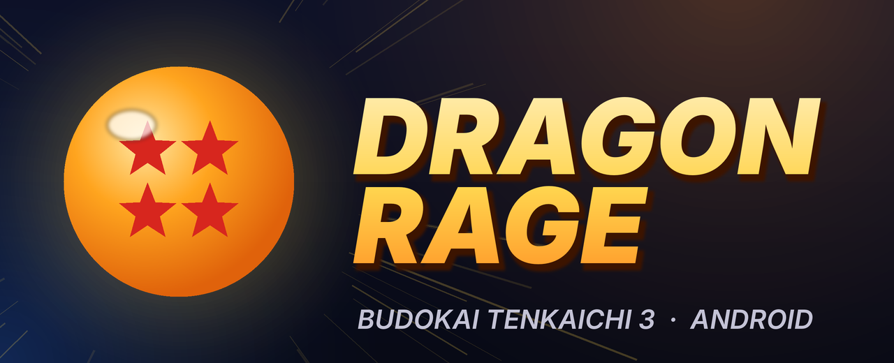

<p align="center">
  
</p>

<h1 align="center">Dragon Rage</h1>

<p align="center">
  <b>Dragon Ball Z: Budokai Tenkaichi 3</b> running natively on Android phones<br>
  Built on <a href="https://github.com/z3xox/Tenkaichi3Decomp">Tenkaichi3Decomp</a> · Android today, iOS planned
</p>

<p align="center">
  <a href="../../releases">Download</a> ·
  <a href="#getting-started">Getting started</a> ·
  <a href="#building">Building</a> ·
  <a href="#português">Português</a>
</p>

---

Dragon Rage is a mobile port of [Tenkaichi3Decomp](https://github.com/z3xox/Tenkaichi3Decomp), the native PC port
of Budokai Tenkaichi 3 (PlayStation 2, USA release, SLUS-21678). The game's own decompiled code is compiled for
ARM64. It is **not an emulator**, so the processor has little to do and the graphics chip does most of the work.

> **No game data is included.** You need an `.iso` of your own disc of the USA release (SLUS-21678). The app takes
> the game's files out of it on your phone, and nothing is downloaded. Share only the app (APK), never the ISO or
> the game data.

## Features

- **Launcher** in the style of the game's own settings window. It follows the phone's language (English,
  Português, Español) and has Play, Settings, Mods and About.
- **Graphics**:
  - internal resolution from 1x to 8x
  - full-screen widescreen, or 4:3, 16:10, 16:9 and 21:9
  - the PS2's effects (outline, glow, depth tint, blurs), each one switchable
  - texture packs made for PCSX2
- **Performance**:
  - a profile chosen from the graphics chip (Mali, Adreno, Xclipse, Immortalis, PowerVR)
  - Smooth motion at 60/120/240
  - frame skipping
  - Fast depth
  - sustained performance mode
  - a compatibility mode for drivers that misbehave
- **Controls**:
  - a PS2 pad on the touch screen that can be resized, moved and made see-through, and hides itself when a
    controller is connected
  - Bluetooth and USB controllers
- **Mods**: each one in its own folder, switched on and off and put in order in the launcher, or imported from a
  `.zip`.
- **Discord Rich Presence** in the official releases: shows the screen you are on (menus, Story mode saga, shop,
  Mission 100, fights with their timer). It can be switched off. Builds made by others come without it.
- **Updates**: the launcher finds a new release here on GitHub and installs it after asking you. It can be
  switched off (Settings > Game).
- **Online** play from the PC port, with rollback: direct IP, or room codes through the matchmaking service when it
  accepts the build.

## Requirements

| | |
|---|---|
| Android | 8.0 (API 26) or newer, 64-bit (arm64-v8a) |
| Graphics | Vulkan support (almost every 64-bit phone from 2018 on) |
| Storage | about 3.5 GB free for the game's data, plus the ISO while installing |
| Game | your own `.iso` of *Dragon Ball Z: Budokai Tenkaichi 3*, USA (SLUS-21678) |

## Getting started

1. Download the newest `DragonRage-x.y.z.apk` from [Releases](../../releases) and install it. Android may ask you to
   allow installing apps from that source.
2. Open **Dragon Rage** and tap **Allow** to give it "All files access". This lets the app keep its folder at the
   root of your storage, where you can reach it with a file manager. You can also tap **Not now**.
3. Tap **Choose ISO...** and pick your disc image. Unpacking takes a few minutes, and you only do it once.
4. Tap **Play**.

In the game, Android's **Back** gesture, a controller's **PS / Home** button or **L3 + R3** open the game's own menu.
It has the touch layout editor, online play, cheats and more.

### Folders

| Where | What |
|---|---|
| `DragonRage/` (root of the storage) | settings, saves, logs, `launcher.txt`, `mods.txt` |
| `DragonRage/textures/` | texture packs (PCSX2 naming, `.dds` or `.png`) |
| `DragonRage/mods/<name>/` | mods, one folder each |
| `DragonRage/stages/`, `DragonRage/songs/` | extra stages and songs ([how](docs/port/adding_stages.md)) |
| `Android/data/io.github.tenkaichi3decomp/files/gamedata/` | the game's data unpacked from your ISO |

The game's data stays in the app's own folder because Android writes there much faster. If you tap **Not now** at
the start, everything lives in that folder instead.

### Mods

A mod is a folder laid out like the game's data, for example `pzs3us1/01234.bin` or `disc/DATA/...`. Put it in
`DragonRage/mods/`, or use **Mods > Import .zip** (the game's folders may sit anywhere inside the zip). In the list,
tick the mods you want and use ▲▼ to order them: the first one that has a file wins. For online play, both players
need the same mods switched on.

### Performance tips

The game runs at 30 frames a second, as on the PS2. **Smooth motion** draws extra pictures in between, which doubles
the graphics work at 60.

| Chip | Try |
|---|---|
| Adreno 730 and newer, Xclipse, Immortalis | 3x, Smooth motion 60 |
| Mali-G6xx/G7xx (e.g. G720), Adreno 6xx | 2x at 60, or 3x at 30 |
| Older Mali-G5x/G7x, Adreno 5xx, PowerVR | 1x–2x; Compatibility mode if the picture is wrong |

**Fast depth** (Settings > Performance) lets the chip skip hidden pixels and helps most at 3x and above.

### Problems and logs

- The game writes `DragonRage/bt3_log.txt` on each run. With a PC, `adb logcat -s bt3` shows the same live.
- A file `DragonRage/bt3_env.txt` with `NAME=value` lines sets test switches. For example, `BT3_GS_VERBOSE=1`
  logs frame times and `BT3_PROFILE=1` logs where the processor spends its time.
- When opening an issue, attach `bt3_log.txt` and say which phone and chip you have (shown in **About**).

## Building

The APK is built without Gradle by [`port/android/build_apk.sh`](port/android/build_apk.sh). It builds SDL3 for
Android, the game, the loader and the Java side, then packs and signs the APK.

### On GitHub (no setup)

[`.github/workflows/android.yml`](.github/workflows/android.yml) builds the APK on every push to `main` (download it
from the run's **Artifacts**). Pushing a tag `vX.Y.Z` also makes a draft release with the APK attached. In a fork it
works as it is. One optional repository secret: `ANDROID_KEYSTORE_B64`, your signing keystore in base64. Updates
install over earlier versions only when both are signed with the same key. The APK is built without the Discord
status, which only the official releases have.

### On your machine (Ubuntu 24.04 or WSL)

```sh
sudo apt install clang-20 llvm-20 lld-20 libclang-20-dev python3-clang-20 glslang-tools cmake ninja-build openjdk-17-jdk
# an Android SDK with an NDK, build-tools and a platform, in ANDROID_HOME
export ANDROID_HOME=~/Android/Sdk
KEYSTORE=path/to/your.keystore bash port/android/build_apk.sh 1.2.3 123   # -> port/build/DragonRage-1.2.3.apk
```

`KEYSTORE` is optional. Version code 123 for 1.2.3 is major×100 + minor×10 + patch.

### How the Android port works

| Piece | Where |
|---|---|
| The game, compiled for `aarch64` with 4-byte game pointers and linked at `0x20000000` (`BT3_CC=android64`) | [`port/tools/toolchain.py`](port/tools/toolchain.py) |
| The loader (`libmain.so`): maps the game image below 4 GB, moves it if that address is taken, runs it on SDL3, starts Discord | [`port/android/native/loader.c`](port/android/native/loader.c) |
| Launcher, data folder, mods, GPU detection, strings | [`port/android/java/`](port/android/java/io/github/tenkaichi3decomp) |
| Touch pad, in-game menu, Discord status texts | [`port/src/gs/ui.cpp`](port/src/gs/ui.cpp) |
| Renderer (Vulkan through SDL3's GPU API) | [`port/src/gs/gs_gpu.c`](port/src/gs/gs_gpu.c), [`gs_draw.c`](port/src/gs/gs_draw.c) |
| APK packer (binary manifest, no aapt) | [`port/android/make_apk.py`](port/android/make_apk.py) |

The PC port's own documentation is in [docs/README_PC.md](docs/README_PC.md) and [docs/port/README.md](docs/port/README.md).

## Roadmap

- **iOS**: planned. The game image's fixed low address, which the Android loader solves by mapping memory itself,
  is the main question on iOS. It will most likely be a sideloaded app (AltStore / SideStore).
- Online: smoother play over Wi-Fi and mobile networks (lag spikes).
- Graphics: glow and blur effects at a lower resolution, fewer render-pass breaks (3x at 60 on mid-range Mali).
- ASTC texture packs.

## Credits and license

- **[z3xox/Tenkaichi3Decomp](https://github.com/z3xox/Tenkaichi3Decomp)**: the decompilation and the PC port this is
  built on, kept up to date with it.
- **License:** like the original, the port's code is under the
  [GNU Affero General Public License v3](LICENSE) (AGPL-3.0-only). Code up to the original's commit `06e4671` is
  also available under [MIT](LICENSE-MIT). Anyone who passes the app on, changed or not, has to offer its source under
  the same license; this repository is that source. The game's own code in `src/` and `include/` comes from the
  decompilation and belongs to the game's rights holders.
- [SDL3](https://libsdl.org) (zlib), [Dear ImGui](https://github.com/ocornut/imgui) (MIT); in the official releases,
  [hxdiscord_rpc](https://github.com/MAJigsaw77/hxdiscord_rpc) (MIT) and the Discord Social SDK (Discord's terms).
- Dragon Ball, Budokai Tenkaichi and all related names belong to their owners. This is a fan project, not affiliated
  with Bandai Namco, Spike or Toei. No game assets are in this repository.

---

## Português

**Dragon Rage** é um port para Android de *Dragon Ball Z: Budokai Tenkaichi 3*, feito a partir do
[Tenkaichi3Decomp](https://github.com/z3xox/Tenkaichi3Decomp). É o código do próprio jogo compilado para o celular,
**não é um emulador**. O suporte a iOS está planejado.

**Você precisa do seu próprio disco** (ISO da versão americana, SLUS-21678). O app não vem com nada do jogo e não
baixa nada. Compartilhe só o APK, nunca a ISO.

**Como usar:**

1. Baixe o APK em [Releases](../../releases) e instale.
2. Abra o app e toque em **Permitir** para dar "Acesso a todos os arquivos". Isso cria a pasta `DragonRage` na raiz
   do armazenamento.
3. Toque em **Escolher ISO...** e aguarde alguns minutos.
4. Toque em **Jogar**.

O launcher segue o idioma do celular e tem configurações de gráficos, desempenho, controles, áudio e mods. O status
no Discord vem só nas versões oficiais.

- **Texturas** vão em `DragonRage/textures`.
- **Mods** vão em `DragonRage/mods/<nome>`, ou entram pelo botão **Importar .zip**.
- **Para compilar**, veja [Building](#building). O GitHub Actions gera o APK sozinho a cada push.
